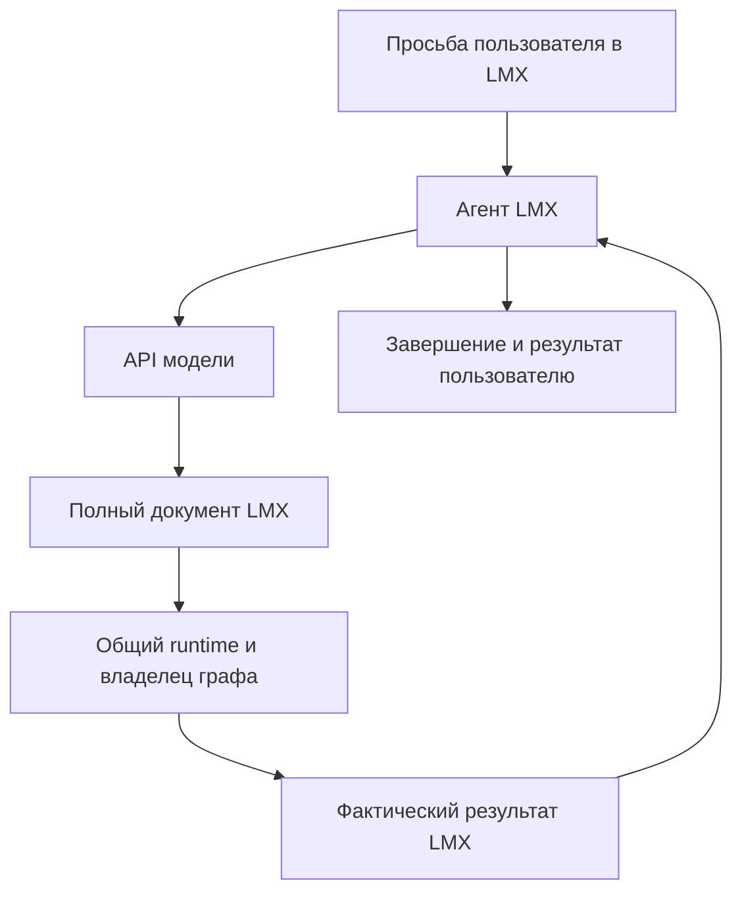

# Runtime LMX как собственный сервер и среда агентов

Редакция: 27 ноября 2026 года. Это проект архитектуры и исходные LMX-заготовки к патчу `LMX_semantics` §36. Возможности, для которых ещё нужны подключения ядра, перечислены в [плане реализации](IMPLEMENTATION_PLAN.ru.md). Код сервера, состояния, вызовы и цикл агента задаются на LMX; платформенный I/O и существующие примитивы ядра подключаются через типизированные контракты.

## 1. Целевой цикл

Пользователь вызывает LMX-метод агента и передаёт просьбу, доступный runtime и настройки модели. Агент получает необходимые фактические наблюдения, вызывает API провайдера, получает **целый законченный LMX-документ**, передаёт его runtime и использует фактический результат в следующем запросе. Завершение задаётся обычным LMX-результатом программы. Ответ модели не подтверждает, что предложенная операция выполнена.

Для внешнего AI-клиента этот же runtime выступает MCP-сервером. Локальный агент может отправить обычный `post` по реальной ссылке сервиса и передать подготовленные LMX-значения. Ни один из этих путей не требует отдельной реализации выполнения команд.

## 2. Одна семантика, несколько способов доставки

| Вход | Что поступает | Подготовка | Исполнение |
| --- | --- | --- | --- |
| Локальный вызов | Настоящие LMX-значения и ссылки | Обычный выбор и допуск | Общий вызов на допустимом owner |
| Локальный `Message/post` | Сформированный ordinary call и его actual | Существующая подготовка `post` | Та же операция на потоке получателя |
| Native text | Полный документ `application/lmx` | Единый parser/builder и явный контекст | Общий runtime |
| MCP | Стандартный JSON-RPC envelope | Версионная проверка MCP; `document` декодируется как точный текст | Тот же native command path |
| Ответ модели | Завершённый текст LMX и provider metadata | Проверка полноты; затем обычная подготовка | Тот же command path |

JSON существует на стандартной границе MCP и, если требуется, API провайдера. Внутренние команды, таблицы, граф, состояние и результаты остаются обычными LMX-структурами. Прямой LMX-порт не называется нестандартной разновидностью MCP wire: клиент MCP получает предусмотренные его версией JSON-RPC сообщения.

В LMX один основной parser, включающий `[]`-подпарсер, который вызывает тот же основной parser для любого выражения и `{...}`. Все потребители пользуются одной реализацией группировки. Транспорт знает длину сообщения; он не считает скобки и не выделяет «похожий на завершённый» префикс программы. Кодек JSON не разбирает и не группирует LMX.

## 3. Что составляет сервер

**Служебный объект runtime.** Обычный LMX-объект хранит явные ссылки на runtime port, допустимый контекст и выбранный handler. Его стабильные входы `submitText` и `submitGraph` выполняются на его owner lane. Подготовленный graph передаётся непосредственно; ненужного `toLmx → fromLmx` между местными агентами нет.

**Агент.** Обычное состояние содержит вопрос, историю фактических результатов, model port, ссылку сервиса и конечный бюджет раундов. Ответы проходят обычные `post/answer`; дополнительная очередь, планировщик или глобальный агентский registry не вводятся. Ссылка callback сохраняет его настоящий parent; состояние callback должно жить дольше ожидаемого ответа.

**Model port.** Типизированный provider получает ordinary exchange и возвращает полный текст либо реальный отказ/незаконченный ответ. Адрес API, модель, credentials, лимиты, формат HTTP/JSON и возможность потокового получения принадлежат этому provider. Sampling MCP не является условием работы собственного агента runtime.

**MCP binding.** Версионный модуль занимается envelope, capabilities, correlation, streaming, запросом дополнительного ввода и отображением результата. Он вызывает тот же сервис, а не другой evaluator. RPC ID обозначает обмен, а не объект графа. Legacy connection state остаётся состоянием соответствующего binding и не становится сессией языка.

**Catalogue port.** Компиляция строит пригодные для поиска факты из LMX-графа. SQLite хранит выбранную проекцию; `toLmx` читает сам runtime. Каталог и служба запросов к нему тоже представлены обычными данными и методами LMX. [Подробный контракт каталога](CATALOGUE_SQLITE.ru.md).

## 4. Полный документ и действительный контекст

Вызов `submitText` получает законченный текст, не фрагмент stream. Ядровой `sys\fromLmx` строит чистый граф, пригодный для компиляции; общая подготовка разрешает имена в переданном контексте и выполняет обычные стадии допуска. Этот же граф исполняется обычным runtime без обязательной компиляции. Она не делает `sys\compile` условием интерпретации программы и не исполняет все defaults или ветви для получения фиктивного глобального статуса checked.

Нужно различать source, placement target, execution target и observation root. Один универсальный строковый `targetId` их не заменяет. Runtime не ищет произвольные объекты по глобальной таблице имён: текстовое имя разрешается обычным способом в явном контексте, а вызов получает настоящую ссылку или PLACE. Путь повторного имени сохраняет обычное `S\[n]field`.

Описание данных не становится командой лишь потому, что попало в результат. Комментарии и просмотренные исходники не расширяют полномочия агента. Доступ определяется обычными правилами выбранного сервиса и контекста. `private` фильтрует неявное связывание, но сам по себе не является защитой секрета от явного чтения графа.

## 5. Изменение поведения без перекомпиляции

Граница расширения — **настоящая изменяемая ссылка на callable**. Стабильный вход сервиса при новом вызове на owner lane читает `node\handler`, сохраняет выбранную ссылку обычным runtime-механизмом и вызывает её. Новый обработчик — обычный callable с собственными DATA, parent и CODE. При отсутствии native association действующий dispatcher выбирает интерпретатор.

Замена handler выполняется обычной записью в реальный owner PLACE. Следующий выбор видит новую ссылку. Уже выбранный callable, сформированное письмо и действующий frame сохраняют прежний смысл; их нельзя молча перепривязать. Поэтому локальный агент обращается к стабильному входу `submitText/submitGraph`, когда ему нужно обслуживание действующей версией.

Это не требует отслеживать все записи графа, очищать native, заводить поколения вызовов или повторять упавший native-вызов через walker. Скопированное старое тело с сохранённым native descriptor не становится новым интерпретируемым обработчиком от изменения его текста. Прямой скомпилированный A→B также не меняется при замене ссылки в другом месте. Явный `compile` и последующий `endturn` сохраняют свой отдельный договор обновления машинного кода.

## 6. Каталогизация, которая помогает агенту

Компилятор видит структуру программы, типы, принимающие роли и разрешённые связи. Эти сведения полезнее одной копии текста. Каталог должен отвечать на конкретные вопросы:

| Вопрос агента | Требуемые факты |
| --- | --- |
| Где подходящая операция? | Имена, описания, типы входов/результата, роли и допустимые профили |
| Как её вызвать? | Сигнатура, required/default/absence, named actuals, `throws`, настоящий DATA/parent |
| Где она используется? | Определения и uses; разрешённые ссылки; read/write/call и их исходные occurrences |
| Что затронет изменение? | Caller/callee, static direct-call dependencies, типовые и импортные зависимости; отдельно неизвестные dynamic targets |
| Что уже исполняется? | Связь callable с графовым телом либо native module/entry/ABI; без переносимых RAM-адресов |
| Что проверено? | Объявленные tests отдельно от результатов фактических запусков, привязанных к конкретному снимку |
| Откуда взялось решение? | Комментарий автора, факт компилятора, вывод анализа и runtime-наблюдение с разным происхождением |
| Что изменилось сейчас? | Прямое чтение runtime и полный `toLmx` разрешённой области; сравнение с явно названным снимком каталога |

Каталогизация не вычисляет произвольные инициализаторы, не угадывает динамическую цель и не доказывает отсутствие эффекта по отсутствию найденного ребра. Статический факт, консервативный набор кандидатов и unknown записываются различимо. Обратный call graph полезен для **явного** анализа/плана перекомпиляции; он не становится механизмом автоматического native invalidation.

Выбранный простой профиль SQLite — одна главная таблица фактов на L3Thread с индексами и проекциями для запросов. Полные LMX-данные могут храниться в типизированном LMX payload; SQL-колонки дают быстрый отбор ключевых признаков. Табличный ключ — ключ каталога, не новый глобальный ID объекта runtime. Точный DDL, границы SQL и примеры запросов вынесены в отдельный документ.

Каталог готовится в цикле явной компиляции и публикуется настоящим owner hook на соответствующем `endturn`. `endturn` не возвращается; код после него не является публикацией. Вход компиляции и graph после interpreted tests могут различаться и именуются отдельно. Сам по себе `endturn` не запускает компиляцию. SQL transaction делает публикацию SQL-проекции цельной; она не откатывает уже выполненные LMX/внешние эффекты и не объявляется общей транзакцией базы, памяти и native entry.

После интерпретируемых изменений без компиляции старый каталог остаётся снимком указанной компиляции. Полное актуальное состояние доступно через runtime `toLmx`. Отсутствие строки в старом каталоге не доказывает отсутствие новой структуры. Файл исходника на диске полезен как provenance или экспорт, но не определяет истинное состояние живой программы.

## 7. Наблюдение, таблицы и большие результаты

LMX-результат может содержать иерархию, `[]@` записей, плотную таблицу, typed Arrays, ссылки и циклы. Образцы используют тот же синтаксис, что существующие table/actor examples. Табличный профиль с `columns` задаёт структуру данных; он не публикует методы и не меняет разрешение имён.

`inspect` должен возвращать реальное наблюдение. Ядровой `toLmx` выдаёт LMX-код любой Structure и любого L3Thread; для Thread сохраняются предусмотренные контрактом таблицы арены. Он сохраняет типы, порядок, пустые позиции, общие ссылки, циклы, имена и исходные receiver-формы. Runtime dump, вставляющий `...`, не годится для этого режима. Если полный кодек ещё не подключён, полный export недоступен; отдельный явно названный preview допустим без обещания восстановимости.

Для больших результатов используются явные диапазоны и continuation. Ответ сообщает режим, границы, полноту и контекст наблюдения. Несколько owner не объявляются одним глобальным snapshot. MCP может вернуть LMX-документ как text content и простые JSON metadata; это не преобразование полного LMX-графа в JSON.

## 8. Ошибки, повтор и остановка

Отказ транспорта до отправки, потерянный ответ, незаконченный ответ модели, ошибка parse/admission, отказ выполненного метода, запрос отмены и подтверждённое завершение различаются. `Receipt.ok` сообщает исход реального исполнения; фактический payload сохраняет тип результата или диагностики. Отсутствие значения не кодируется выдуманным `@0`.

`timeout` в `post` отсчитывается от исходной отправки и не отменяет работу, не уничтожает маршрут позднего ответа. MCP binding соблюдает собственный versioned cancellation contract и передаёт runtime допустимый запрос остановки. Он не обещает прервать любую native-инструкцию или вернуть прежнее состояние графа.

После неизвестного исхода эффектная команда не отправляется заново автоматически. Продолжение диалога использует наблюдения и явную политику конкретного метода. MRTR или task continuation возобновляет сохранённую работу, а не повторяет уже выполненные эффекты по новому RPC ID.

Агентский бюджет раундов ограничивает цикл provider calls. Исчерпание бюджета, malformed Decision или незаконченный model answer дают отдельное остановленное состояние, не успешное выполнение просьбы. Это прикладная политика заготовки, а не новый планировщик языка.

## 9. Основание в поставленных материалах

Прочитаны текущие архивы `27-Nov-2026-doc.tar.gz` + `27-Nov-2026-doc-tensor-patch.tar.gz` и `selfbuild.tar.gz`. Источники и хэши перечислены в [отчёте состояния ядра](SOURCE_EVIDENCE.ru.md). Основные опорные точки: typed call/native-or-walker dispatch, удержание body/data/code, обычный copy engine, mail/turn, реальные Table/actor/post examples. Нынешняя краткая глава §36 расширяется патчем на основании этих материалов.

Требования стандартного MCP, версии и источники приведены в [MCP_COMPATIBILITY](MCP_COMPATIBILITY.ru.md). В этом проекте native LMX, local Message, MCP и API модели не порождают четыре реализации runtime: они приводят вход к одним и тем же обычным LMX-вызовам.
